# ctx-handoff guide

[繁體中文](guide.zh-TW.md)

Everything about ctx-handoff in one place: how each feature behaves, every setting and command, what it costs, what it sends and stores, where it works, its limits, and how to fix or remove it. For the overview, see the [README](../README.md).

## What it does

### Handoff when the conversation is nearly full

Off by default: nothing happens at the threshold and Claude Code's own compact handles it. With `auto_handoff` turned on in the panel's Settings tab, at 600k tokens (80% of smaller windows) it waits for Claude to finish its turn, its background tasks and subagents, then writes a handoff summary, clears the conversation and sends the summary into the new one. The new conversation says what it understood and waits for you.

The summary keeps apart what was verified (tests run, results seen), what was only changed and what was only discussed, lists approaches that failed so they aren't tried again, notes anything still running or unsaved, keeps limits you set ("ask before pushing") in your own words, records what was already found out (where things are, counts, root causes) and how to run the tools, and ends with one concrete next step. Questions waiting for you come with their background and options, so you can answer without scrolling back. Its length follows the work, with no word cap.

- Background work that never ends (a dev server) doesn't block it forever: it hands off anyway 150k tokens past the threshold, and before 90% of the window.
- Anything you type during a handoff goes to the new conversation with the summary. Attachments can't be held; you're asked to paste them again.
- `/handoff now` hands off right away; `/handoff dry` shows a summary and its cost without clearing.

### Cache kept warm while you're away

After about 50 idle minutes it sends a tiny request so the conversation cache doesn't expire (and stays ahead of Claude Code's 54-minute idle compaction on large chats), up to 3 times (about 3.5 hours). After that it saves a handoff summary but doesn't clear. When you come back, your first message is held and you choose: `/handoff resume` starts a new conversation from the summary, `/handoff continue` stays where you were.

### Project notes



What you correct or explain is collected into one notes file per project, loaded into each new conversation. It's plain Markdown you can edit: `~/.claude/projects/<project path>/memory/ctx-handoff.md`.

- **Memories:** preferences (including how you like to work and be talked to), corrections, decisions with their reasons, facts and locations. Decisions that only matter for the task at hand go to the progress note instead, and anything already in your CLAUDE.md files isn't repeated. Preferences and corrections from the last 14 days or confirmed more than once load in full (and only when they match something you actually said); older one-off items and facts/locations load as titles so Claude can read the rest when it needs it. Facts and one-off corrections unconfirmed for 30 days are archived (not loaded, not deleted). Conversations started directly in your home folder don't auto-update or auto-load project notes, so unrelated throwaway chats don't pile into one file. Memories you delete (in the panel, with `tools/notes.mjs` or by editing the file) are remembered for 90 days, and distill won't add them back unless you bring them up again.
- **Rules:** practices that keep coming up, such as "use forward slashes in Bash paths (3 times)". The count is how many times you had to say it: Claude simply following a rule doesn't add to it. Loaded once seen twice.
- **Procedures:** multi-step routines you had Claude repeat, such as "release: bump the version → changelog → tag → GitHub release". Not loaded, to keep the context small.

The notes update every 30 of your messages, after 50 idle minutes, before a handoff, or on `/handoff distill`. Only the new part of the conversation is sent, to Sonnet 5.5 at low effort; a short update takes about 1,200 tokens. Conversations under 30k tokens are skipped. Anything that looks like a key or password is dropped. The status line counts down ("18 more messages until notes update").

**Into your repo after 3 times.** When a rule has come up 3 times (or a guard is on), the next conversation in a git repo asks Claude, after it finishes what you asked, to put it where your project keeps its rules: CLAUDE.md, AGENTS.md or an existing hook. A procedure that came up 3 times becomes a project skill, `.claude/skills/<name>/SKILL.md`. Claude checks for duplicates, doesn't commit, and tells you in one line what it added and where, so it shows up in your usual diff. Claude doesn't have to report anything: the next notes update sees the change in the conversation and checks the file exists. If that conversation ends before it's done, a later one is asked. From then on the repo holds it, for every machine and tool, and ctx-handoff stops loading its own copy. Say no and it's undone and not asked again.

### Where you left off

If you `/clear` yourself, Claude Code crashes, or you just open a new conversation, the new one doesn't know where the last one stopped. Each notes update therefore also keeps a short progress note for the folder: the task, whether it's done, in progress or blocked, the last check that passed, the next step, decisions that only matter until this task is done, and the key files. It rides in the same request as the notes.

The next conversation in that folder is told about it once, within 7 days (covering weekends): "the last conversation (2 hours ago) stopped at…". If you carry on, Claude starts from there; if you're doing something else, it ignores it. Conversations that were handed off automatically don't get it, since the summary already covers them.

### Nudges

Short messages to Claude, never a block on your tools. All on by default.

- **Repeated failure:** when a tool fails twice in a row for the same reason, Claude is told to find the cause and change approach instead of retrying as is, unless the error looks temporary (a timeout, a page still loading), in which case it waits and tries once more. Edit and MultiEdit failures point at checking the exact text with Grep or Read and using the safe-replace tool for multiple changes; Read failures point at Glob. A second reminder follows at the fourth consecutive failure.
- **"Done" without checking:** when Claude says it's done after editing code this turn with no passing test, build or check since (or after a check failed), it's asked once to verify and show the result, or say honestly what failed or couldn't be verified. Doc and scratchpad edits don't count. It's also asked to end with one of four states: done and tested, deployed but awaiting acceptance, changed but not tested (with the reason), or waiting for your decision. Claude Code shows this as "Stop hook feedback" and may label it a Stop hook error; that's the nudge, not a failure.
- **Reply language:** when Claude's explanation is mostly not in your language (Traditional or Simplified Chinese, English, Japanese), it's reminded once. Code, commands, paths, links and short lines are ignored, so Chinese with English terms is fine. It also fires when you asked for another language on purpose, such as a translation.

### Guards

A guard is for a rule that writing down didn't fix: one that went into your repo and you had to correct again, or one you kept out of the repo but have said 3 times. ctx-handoff drafts a check on tool calls from it in the background, such as "git push without running tests", set to block or to remind. The next conversation has Claude, after finishing what you asked, ask you in a sentence or two whether to use it. Say yes or no in the conversation; the next notes update records your answer, so there's nothing to click. If you don't answer, a later conversation asks again. **Nothing applies until you say yes** (or turn it on in the panel or with `/handoff guard on N`). `/handoff guard suggest` drafts on demand. If a check itself fails, the call goes through.

### Panel

`/handoff panel` opens a panel above the prompt. Its top row lets you pause or resume away work for this session, above five tabs: guards to approve, memories, rules and procedures (the tab label shows both counts), the latest notes update (with session background token usage and recent records), and settings. Deleting a guard, memory, rule or procedure takes two presses (deleting a note backs up the file first). Click the buttons, or press ctrl+x tab and then 1–5 to switch tabs. Run the command again to close it.


## Settings

Everything is set on the panel's Settings tab, not in `/config`. Numbers step with `−` and `＋`; switches and choices change with Toggle. Each row shows where its value comes from (panel, settings.json or default), More explains it, and Reset drops the panel's value. Changes apply at once in the current session and from the next message in other open ones. They cover all your projects and survive updates.

| Setting | Default | Meaning |
|---|---|---|
| `auto_handoff` | off | Hand off at the threshold; when off, Claude Code's own compact takes over |
| `threshold` | `600000` | Context tokens that trigger a handoff |
| `window_ratio` | `0.8` | On smaller windows, hand off at `window × ratio` |
| Keep cache warm | on | Also `/handoff refresh on\|off` |
| `idle_minutes` | `50` | Idle minutes before each keep-warm request (5–59) |
| `max_refresh` | `3` | Keep-warm requests per idle period before saving a summary instead |
| `away_handoff` | on | Save that away summary (then `/handoff resume` or `continue` on return); off with keep-warm off means nothing happens while you are away |
| Project notes | on | Also `/handoff distill on\|off` |
| `distill_every` | `30` | Your messages between notes updates (5–200) |
| `min_tokens` | `30000` | Smaller conversations skip cache keeping, away summaries and notes |
| `notes_model` | `claude-sonnet-5-5` | Model for notes: Sonnet 5.5 or Opus 5.5 |
| `resume_hint` | on | Tell a new conversation where the last one stopped |
| `retry_nudge` | on | Repeated failure nudge |
| `done_check` | on | "Done" without checking nudge |
| `reply_language` | `auto` | Reply language nudge: `auto`, `off`, `zh-TW`, `zh-CN`, `en` or `ja` |
| `language` | `auto` | Language of the status line, notices and panel: `auto`, `en` or `zh-TW` |

`auto` follows Claude Code's own `language` setting. For the reply language, an unset `language`, or just "Chinese" without Traditional or Simplified, means off. For messages, it falls back to your system language. Notes and summaries are written in the language you use in the conversation.

**Choosing a threshold:** quality is commonly seen to start slipping around 200k–300k tokens. The 600k default trades that for fewer handoffs; lower it if Claude gets worse before the handoff.

**In a file instead.** The VS Code extension doesn't show the panel. There, or if you'd rather keep settings in a file, put them in `~/.claude/settings.json` (for a clone, the key is `ctx-handoff@inline`). A value set on the panel wins over the file.

```json
"pluginConfigs": { "ctx-handoff@ctx-handoff-mod": { "options": { "threshold": 400000, "reply_language": "zh-TW" } } }
```

## Commands

You won't need these in normal use. If `/handoff` is taken by your own command or skill, it's `/ctx-handoff` instead.

| Command | Purpose |
|---|---|
| `/handoff` | Context use, what's on, the latest progress note and recent errors |
| `/handoff panel` | Open or close the panel |
| `/handoff now` | Hand off now (clears the conversation) |
| `/handoff dry` | Show a handoff summary and its cost, without clearing |
| `/handoff distill` | Update the project notes now |
| `/handoff resume` / `continue` | After being away: start fresh from the summary, or stay |
| `/handoff resend [source-session-id]` | Send an undelivered summary again; specify its source session after a restart, in the same workspace |
| `/handoff away pause\|resume` | Pause away work for this session or restart its idle timer now; notes updates keep running |
| `/handoff refresh on\|off`, `distill on\|off` | Turn cache keeping or project notes on or off |
| `/handoff guard` | List guards; `suggest` drafts new ones, `on\|off\|drop N` approves, turns off or deletes one, `mode N deny\|remind` switches between blocking and reminding |

## Cost, privacy and permissions

**Cost.** Everything runs on your own Claude Code sign-in and counts toward your usage like any other request.

- Handoff: one request that reads the conversation (mostly from cache) and writes the summary, about 30 seconds at 800k tokens.
- Keeping the cache warm: a tiny request that reads the conversation from cache, at about a tenth of the normal input price; at most 3 per idle period.
- Notes: only the new part of the conversation, to Sonnet 5.5 at low effort. The progress note rides in the same request.
- The nudges make no requests.

**What leaves your machine.** Nothing goes anywhere but Anthropic, through Claude Code, like the conversation itself. A notes update sends your messages, Claude's replies and tool calls (the first 300 characters of each input and 500 of each result), up to 300,000 characters.

**What it stores locally:**

| What | Where |
|---|---|
| Project notes | `~/.claude/projects/<project path>/memory/ctx-handoff.md` |
| Backups made before deleting from the panel | `.ctx-handoff-backup/` next to the notes file |
| Settings set on the panel, recent handoff summaries, progress notes, errors | `~/.claude/plugins/store/ctx-handoff_*.json` |

**What it's allowed to do.** Mods aren't sandboxed; this one runs with your permissions. To see what it uses without running it, run `claude plugin validate <ctx-handoff folder>`. It prints a `hooks:` line (events it receives) and a `calls:` line (what its code calls):

| In the output | Why |
|---|---|
| `tool.call` | Applies guards you approved; notices repeated failures and whether tests ran after edits; carries the reply language nudge |
| `turn.step` | Reads the visible text of Claude's replies in the main conversation to check their language. It doesn't change the request, the model or the reply |
| `prompt.submit`, `prompt.context` | Holds your message during a handoff; loads notes and the progress note into a new conversation; rereads settings |
| `$.session.messages`, `$.model.complete`, `$.model.fork` | Reads the conversation to write notes and handoff summaries |
| `$.fs.read`, `$.fs.write`, `$.fs.exists` | Reads and writes the notes file and its backups; checks whether the project is a git repo, and whether a file a rule was put in exists |
| `$.prompt.submit`, `$.command.run` | Sends the summary into the new conversation; runs `/clear` |
| `$.env.get` | Reads three environment variables, `CLAUDE_CONFIG_DIR`, `HOME` and `USERPROFILE`, only to find your `~/.claude` folder. Nothing needs to be set |
| `$.settings.read`, `config.set` | Reads Claude Code's `language` setting and this plugin's `pluginConfigs`; notices when you change Claude Code's settings |
| The rest: `session.start`, `session.end`, `turn.complete`, `classic.Stop`, `command.run`, `$.command.register`, `ui.render`, `$.store`, `$.state`, `$.clock`, `$.ui`, `$.agent.list`, `$.session.*` | Bookkeeping: timers, the `/handoff` command, status line, panel and notices, its own storage, checking that Claude and its subagents are done before a handoff, and the "done" nudge |

It makes no network requests of its own and starts no programs (no `$.http` or `$.process` calls). To run a session without any mod, start Claude Code with `claude --safe-mode`. See also [`SECURITY.md`](../SECURITY.md).

## Where it works

Mods load in most places Claude Code runs, but only the terminal and the Desktop app draw what a mod shows ([Claude Code docs](https://code.claude.com/docs/en/plugins/mods/overview#where-mods-run)).

| Where | Background features | Status line and panel | Checked |
|---|---|---|---|
| `claude` in a terminal (also an editor's terminal, JetBrains) | Yes | Yes | Tested |
| `claude -p` | Yes; `/handoff` replies as text | No | Tested |
| Desktop app, Code tab | Yes | Yes | From the docs |
| VS Code extension chat panel | Yes (settings via `settings.json`) | No | From the docs |
| Desktop app, WSL session | No (plugins don't load there) | No | From the docs |

## Limitations

- **On a 5-minute cache, turn cache keeping off.** API key, Bedrock and Vertex users, and subscribers who've moved onto usage credits, get a 5-minute cache, so a refresh at 50 minutes rewrites the whole cache. Run `/handoff refresh off`; this isn't detected automatically.
- **Notes follow the folder you start in.** Work on another project from your home folder is noted under your home folder. Notes aren't shared across projects.
- **The progress note is only as fresh as the last notes update.** After a short chat or a crash it may be missing or a few messages behind; run `/handoff distill` before `/clear` if you want it exact. Two conversations open in the same folder see each other's note.
- **Other sessions pick up a settings change on their next message,** not at once.
- **Updating the mod mid-handoff may lose a held message.** The cache timer isn't affected.

## Troubleshooting

Start with `/handoff`: it shows context use, what's on, and the latest error from the background.

| Symptom | What to check |
|---|---|
| `/handoff` isn't a command | The mod isn't loaded: check `claude plugin list` and your Claude Code version; for a clone, use an absolute path. If you have your own `/handoff`, use `/ctx-handoff`. |
| Something odd and you suspect a mod | Start with `claude --safe-mode` and see whether it goes away. |
| The new conversation didn't get the summary | `/handoff resend`. After a restart, use `/handoff resend <source-session-id>` from the failure message. Only records with a matching workspace source can be resent. |
| Notes never update | Conversations under 30k tokens are skipped. Run `/handoff distill` and look for an error in `/handoff`. |
| A command gives no answer | Run `/handoff` for the latest error, then [open an issue](https://github.com/cablate/ctx-handoff-mod/issues/new/choose) with its output. |

## Uninstall

1. From the marketplace: `claude plugin uninstall ctx-handoff@ctx-handoff-mod`. From a clone: remove its path from `CLAUDE_CODE_PLUGIN_DIRS` (or stop passing `--plugin-dir`) and delete the folder.
2. Optional: delete the files listed under [What it stores locally](#cost-privacy-and-permissions); uninstalling leaves them. The notes are plain Markdown, so you may want to keep them.

To turn it off for a while instead, disable it in `/plugin`.

## Run from source

Load a clone instead of the marketplace copy; saved edits take effect right away.

```sh
git clone https://github.com/cablate/ctx-handoff-mod ~/.claude/mods/ctx-handoff
claude --plugin-dir ~/.claude/mods/ctx-handoff
```

To load it in every session, add its absolute path to `env` in `~/.claude/settings.json` (separate several paths with `;` on Windows, `:` elsewhere):

```json
"env": { "CLAUDE_CODE_PLUGIN_DIRS": "/home/you/.claude/mods/ctx-handoff" }
```
